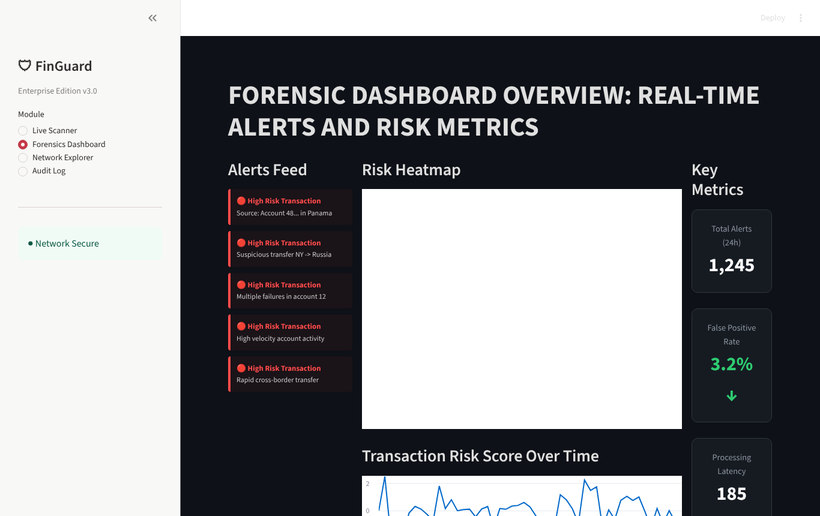
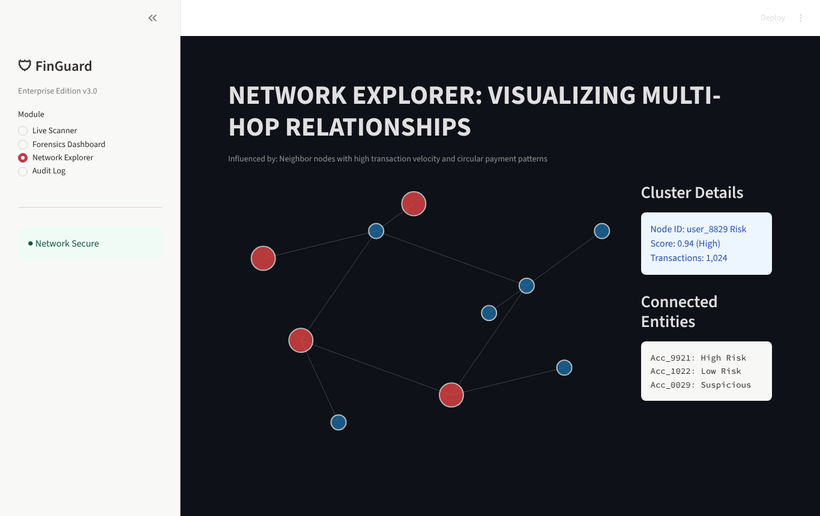
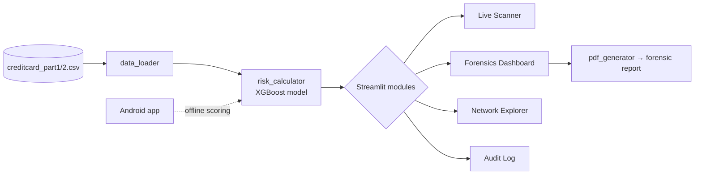

<div align="center">



# 🏦 FinGuard Enterprise

### AI fraud-detection command centre — XGBoost scoring, forensics dashboard, network explorer, PDF reports

     

[](LICENSE)    

[](https://codespaces.new/shiroonigami23-ui/Bank-Security?quickstart=1) [](https://github.com/shiroonigami23-ui/Bank-Security/archive/refs/heads/main.zip)

[**🚀 Live Demo**](https://kaks-bank-security.streamlit.app) · [**Overview**](#-overview) · [**Features**](#-features) · [**Architecture**](#-architecture) · [**Getting Started**](#-getting-started) · [**Roadmap**](#-roadmap)

</div>

---

## 📸 Preview

<p align="center"></p>

## 📖 Overview

**FinGuard Enterprise** is an analyst-facing fraud-detection system for banking transactions. An **XGBoost** model trained on
the credit-card fraud dataset scores transactions in real time; analysts work from a **Streamlit** command centre with a
**live scanner**, a **forensics dashboard** (alerts feed, risk heat-map, risk-over-time, key metrics), a **network explorer**
that visualises multi-hop relationships between accounts, and an **audit log**. Any case can be exported as a
**forensic PDF report**, and an independent **Android app** performs offline transaction-risk analysis.

### ✨ Highlights

- **XGBoost** fraud scoring (`fraud_model_xg.pkl`)
- **Network explorer** — multi-hop account relationships and cluster details
- **Forensic PDFs** for case files
- **Live demo** on Streamlit Cloud + offline Android APK

## 🧩 Features

| Feature | What it does |
|---|---|
| **Live scanner** | Simulated transaction stream scored by the model |
| **Forensics dashboard** | Alerts feed, risk heat-map, risk-score timeline, false-positive rate, latency |
| **Network explorer** | Graph of accounts with high-velocity and circular payment patterns |
| **Audit log** | Every analyst action recorded |
| **PDF reports** | `modules/pdf_generator.py` |
| **Risk engine** | `modules/risk_calculator.py` |
| **Role login** | Credential-gated access to the mainframe UI |
| **Android app** | Native offline risk analysis (`android/`) |

## 🛠 Tech Stack

| Layer | Technology |
|---|---|
| ML | XGBoost, scikit-learn, joblib |
| UI | Streamlit, Plotly, streamlit-lottie |
| Data | pandas, NumPy (credit-card fraud dataset, split into two CSVs) |
| Reports | FPDF |
| Mobile | Android |

## 🏗 Architecture

Streamlit pages sit on four modules — data loading, risk calculation, UI components and PDF generation.



➡️ Full design notes, data flow and design decisions: **[docs/ARCHITECTURE.md](docs/ARCHITECTURE.md)**

## 📁 Project Structure

```text
Bank-Security/
├── main.py                 # Streamlit app + login + module router
├── modules/                # data_loader, risk_calculator, ui_components, pdf_generator
├── fraud_model_xg.pkl      # trained XGBoost model
├── creditcard_part1.csv · creditcard_part2.csv
├── style.css
├── android/                # offline Android app
└── FinGuard_Launcher.bat   # Windows launcher
```

## 🚀 Getting Started

### Prerequisites

- Python 3.10+

### 1. Get the code

Pick whichever method suits you:

| Method | Command |
|---|---|
| **HTTPS** | `git clone https://github.com/shiroonigami23-ui/Bank-Security.git` |
| **SSH** | `git clone git@github.com:shiroonigami23-ui/Bank-Security.git` |
| **GitHub CLI** | `gh repo clone shiroonigami23-ui/Bank-Security` |
| **ZIP** | [Download](https://github.com/shiroonigami23-ui/Bank-Security/archive/refs/heads/main.zip) and extract |
| **Codespaces** | [Open in browser](https://codespaces.new/shiroonigami23-ui/Bank-Security?quickstart=1) — zero local setup, dev container preconfigured |

> 🔑 **Using SSH for the first time?** Generate a key with `ssh-keygen -t ed25519 -C "you@example.com"`, add the `.pub` contents at **GitHub → Settings → SSH and GPG keys**, then test with `ssh -T git@github.com`.

### 2. Install & set up

```bash
cd Bank-Security
pip install -r requirements.txt
```

### 3. Run

```bash
streamlit run main.py      # http://localhost:8501
```
Windows users can double-click `FinGuard_Launcher.bat`.

## 🗺 Roadmap

**v4.1 — Current (done)**

- [x] XGBoost scoring, 4 analyst modules, PDF reports
- [x] Streamlit Cloud deployment and Android APK

**v4.2 — Security hardening**

- [ ] Move credentials to hashed secrets / OAuth instead of in-code demo users
- [ ] Role-based permissions per module
- [ ] Persist audit log to a database

**v5.0 — Smarter detection**

- [ ] SHAP explanations per alert
- [ ] Graph-based features (GNN) from the network explorer
- [ ] Streaming ingestion (Kafka) and drift monitoring

➡️ Detailed plan, milestones and long-term vision: **[docs/ROADMAP.md](docs/ROADMAP.md)**

## 🤝 Contributing

Contributions, issues and feature requests are welcome!

1. Fork the repository
2. Create a feature branch: `git checkout -b feature/amazing-feature`
3. Commit your changes: `git commit -m "feat: add amazing feature"`
4. Push the branch: `git push origin feature/amazing-feature`
5. Open a Pull Request against `main`

Check the [issues page](https://github.com/shiroonigami23-ui/Bank-Security/issues) and the [roadmap](docs/ROADMAP.md) for ideas on where to help.

## 📜 Changelog

See [CHANGELOG.md](CHANGELOG.md) for the release history.

## 📄 License

Distributed under the **MIT** license. See [LICENSE](LICENSE) for details.

## 👤 Author

**Aryan Singh Chandel** (Shiro)

[](https://github.com/shiroonigami23-ui)

<div align="center">

⭐ **If you find this project useful, consider giving it a star!** ⭐

</div>
