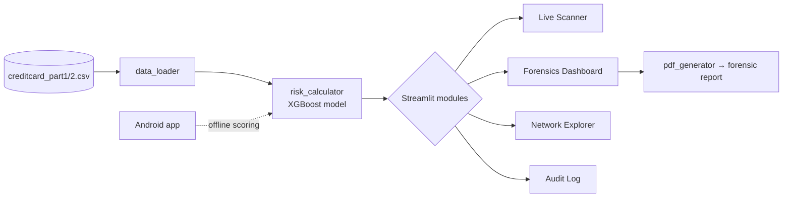

# 🏗 Architecture — FinGuard Enterprise

> Part of [Bank-Security](https://github.com/shiroonigami23-ui/Bank-Security). Back to the [README](../README.md).

## 1. System Overview

`main.py` handles login and routes between four modules. Data is loaded once, scored by the XGBoost model through the
risk calculator, and rendered with Plotly components. Reports are generated on demand as PDFs.

## 2. Components

| Component | Location | Responsibility |
|---|---|---|
| **App shell** | `main.py` | Login, navigation, layout |
| **Data** | `modules/data_loader.py` | Loads and merges transaction CSVs |
| **Risk** | `modules/risk_calculator.py` | Model inference and risk tiers |
| **UI** | `modules/ui_components.py` | Cards, charts, animations |
| **Reports** | `modules/pdf_generator.py` | Forensic PDF |

## 3. Data / Control Flow

1. The analyst signs in and picks a module.
2. Transactions are scored; high-risk ones populate the alerts feed.
3. The network explorer links suspicious accounts; any case can be exported to PDF.

## 4. Key Design Decisions

| Decision | Rationale |
|---|---|
| XGBoost | Strong on tabular, imbalanced fraud data |
| Streamlit | Fast analyst UI with zero front-end code |

## 5. Known Limitations

- Demo credentials are defined in code; replace before real use

---
*Last updated: 2026-11-13*
